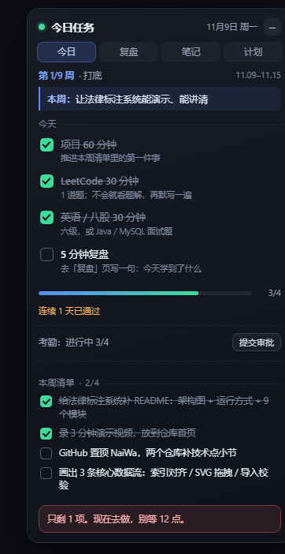
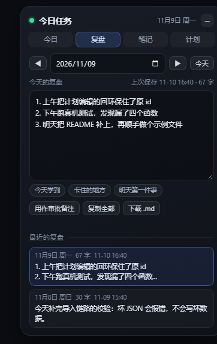
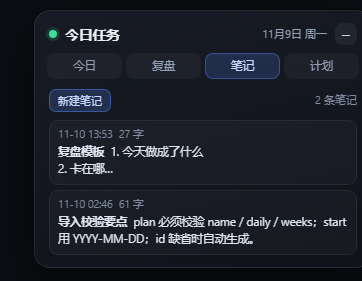
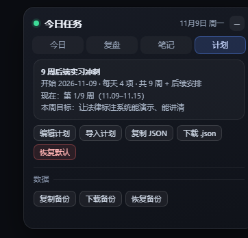

# dsh-daily-coach

DSH Web GUI 右上角的每日打卡面板：4 件每日习惯 + 本周清单 + 连续全勤 + AI 审批考勤，能写**复盘**、**笔记**，计划可以随时**改**或**导入**。纯 DOM 实现，无宿主侧逻辑。

| 今日 | 复盘 | 笔记 | 计划 |
| --- | --- | --- | --- |
|  |  |  |  |

> 截图来自 `preview.html`（伪造 DSH 模块加载器的本地预览页），所以背景是空的，面板本身和真实 DSH 里一样。

## 它长什么样

- 默认固定在右上角，深色玻璃卡片；点「−」折叠成一枚「今日 N/4」胶囊，再点胶囊展开。
- 按住标题栏（「今日任务」那一行）可以拖到任意位置，折叠后的胶囊也能拖。位置写进 localStorage，重启后还在，窗口变小时自动收回可视区域。
- 四个页签：

| 页签 | 内容 |
| --- | --- |
| 今日 | 第 N/9 周 · 本周目标、每日习惯（勾选即存）、进度条、考勤行（AI 审批）、本周清单、按小时变化的催促语 |
| 复盘 | 按日期写当天复盘（自动保存）、「今天学到 / 卡住的地方 / 明天第一件事」快捷插入、最近复盘列表、导出 .md |
| 笔记 | 新建 / 编辑 / 删除笔记，列表按更新时间倒序；点一条进入编辑，点「完成」收起 |
| 计划 | 当前计划摘要；编辑计划（JSON）、导入新计划（JSON / 从文件）、复制 / 下载 / 恢复默认；备份区：复制 / 下载 / 恢复 |

## 数据都在浏览器里

全部状态写 localStorage，没有后端。键名：

- `dsh-daily-coach.v2`：打卡、复盘、笔记、折叠状态、面板位置、待审批备注
- `dsh-daily-coach.plan.v1`：当前使用的计划

v0.1 的 `dsh-daily-coach.v1` 会在首次打开时自动迁移成 v2（打卡按自然日保留，周清单键从 `w1` 改成 `<planId>:w1`），迁移只做一次，旧键不删。

> 换浏览器 / 换机器 / 清站点数据都会丢。要搬走就用「计划 → 复制备份」，粘成文件保存。

## 计划：改与导入

计划是一段 JSON，可以直接在「计划 → 编辑计划」里改，也可以「导入计划」整体替换。切换计划只换周清单，**按日打卡历史全部保留**（历史按 plan.id 隔离，来回切也不串）。

```json
{
  "name": "9 周后端实习冲刺",
  "start": "2026-11-09",
  "daily": ["项目 60 分钟", "LeetCode 30 分钟", "英语 30 分钟", "5 分钟复盘"],
  "weeks": [
    { "goal": "本周目标的一句话", "items": ["清单项 1", "清单项 2", "清单项 3", "清单项 4"] }
  ]
}
```

- `start`：第 1 周的周一（`YYYY-MM-DD`），用它推算今天是第几周。
- `daily`：每天固定的习惯，1–6 条；条数变了只会影响当天的勾选位数，周清单不会丢。
- `weeks`：本周清单，缺的那一周显示为空。
- `id` 可省略，导入时自动生成；恢复默认 = 内置的 9 周计划（id `default-9w`）。
- 导入会覆盖整份计划并保留每天打卡，导入前会提示当前计划是什么。

示例文件：[`examples/plan.example.json`](examples/plan.example.json)。

## 审批模式：4 项做完不算数，AI 审批通过才算考勤

1. 4 项全勾后，点「提交审批」，在备注里写清楚今天实际做了什么（至少 5 个字，要具体：改了哪个文件、LeetCode 哪一题、英语用的什么材料）。
2. 点「复制审批请求」，把全文粘贴到 DSH 对话框发给 AI。
3. AI 核对后回复 6 位审批码；把码填进「审批码」→「确认」。
4. 通过后考勤显示「已通过 AI 审批 ✓」，连续天数才会 +1；折叠时胶囊显示「今日 4/4 ✓」。

审批码绑定「日期 + 备注」：复制之后再改备注、或抄错一个字符，都会验证失败。剪贴板不可用时，页面会自动展开请求全文供手动复制。

### AI 侧怎么生成审批码

```bash
node approve-code.js 2026-11-08 "备注原文"
node approve-code.js --check 2026-11-08 "备注原文" B4Z3Y9
```

算法与 `client.js` 里的 `expectedCode` 完全一致（FNV-1a + 6 位字母数字，跳过易混字符），所以审批码不能靠猜。

## 安装（本地插件，桌面版）

桌面 profile 由 Electron 独占管理，`dsh plugin --profile desktop ...` 会被拒绝，只能手动装：

1. 把本仓库放进 `<profile>/node_modules/dsh-daily-coach`（可以 `git clone` 到那里，也可以直接复制目录）
   （本机：`D:\DSH\home\profiles\desktop\node_modules\dsh-daily-coach`）
2. 编辑 `<profile>/package.json`：
   - `dependencies` 加 `"dsh-daily-coach": "file:<本目录绝对路径>"`
   - `dsh.profile.bundles` 数组追加 `"dsh-daily-coach"`
3. 重启 DSH。

改完代码后要把文件重新复制进 profile 再重启（profile 里是拷贝，不是软链）。

## 本地预览

不装进 profile 也能看效果：直接双击 `preview.html`（它伪造 DSH 的模块加载器），数据同样写 localStorage。

## 重置

浏览器控制台执行（会清掉打卡、复盘、笔记和当前计划）：

```js
localStorage.removeItem('dsh-daily-coach.v2')
localStorage.removeItem('dsh-daily-coach.plan.v1')
```

只重置打卡、保留复盘和笔记：删掉 `v2` 里的 `days` 字段，再刷新。

## 目录结构

```
client.js              全部界面与逻辑（浏览器端，约 2000 行）
lib/index.js           宿主端空壳，只为让 client 包进页面
cordis.patch.yml       插件清单补丁（dsh.bundle.patch）
preview.html           本地预览页
approve-code.js        命令行算审批码（与 client.js 算法一致）
examples/plan.example.json
docs/                  截图
```

## 许可

MIT，见 [LICENSE](LICENSE)。
